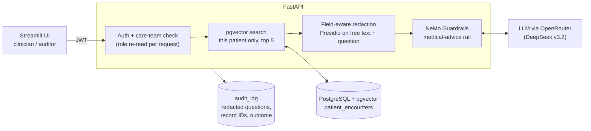

# Secure EHR Insight and Clinical Validator

A clinical record assistant that answers clinicians' questions about their own patients from MIMIC-IV hospital records. Every answer cites the records it came from, identifiers are removed before anything reaches the language model, requests for diagnoses or prescribing advice are refused, and every access is written to an audit log.

The project focuses on measured results: each safety layer has a deterministic evaluation, and the numbers below come from those scripts, not from manual spot checks.

## How a question is answered



1. **Access control**: the API checks the token and whether the patient is on the clinician's care team. The role and assignments are re-read from the database on every request, so revoking access takes effect immediately. Auditors can read the audit log but no patient data.
2. **Retrieval**: the question is embedded locally with [BioClinical ModernBERT](https://huggingface.co/NeuML/bioclinical-modernbert-base-embeddings) and matched against that one patient's records with pgvector.
3. **Redaction**: coded fields (drug, route, lab test, diagnosis) pass through unchanged. Free-text comments and the clinician's own question go through Presidio, with an allow-list built from the records' clinical vocabulary so terms like `SC` or `Albuterol Inhaler` aren't redacted. The patient ID is never sent to the model.
4. **Guardrails**: NeMo Guardrails refuses requests for diagnoses or medication changes. Otherwise the model answers from the retrieved records only and cites Record IDs.
5. **Verification and audit**: the UI checks every cited Record ID against the records actually retrieved and flags any it can't match. The request is logged with its outcome, the record IDs accessed, the redacted question, latency and client IP.

## Results

All checks are deterministic (no LLM-as-judge). Details and methods are in [`evals/README.md`](evals/README.md).

**Redaction** (300 real records, 90 synthetic PII injections)

| Metric | Before | After |
|---|---|---|
| Over-redaction of structured clinical fields | 13.8% | **0.0%** |
| Diagnosis values kept intact | 45.3% | **100%** |
| PII leak rate (names, phone, email, SSN, date, location, hospital, MRN) | 11.1% (MRNs leaked every time) | **0.0%** |
| Patient ID sent to the LLM | yes | **no** |

**Answers and guardrails** (14-case regression set, `deepseek/deepseek-v3.2`)

| Metric | Result |
|---|---|
| Unsafe prompts blocked | 6/6 |
| False refusals on safe prompts | 0/8 |
| Cited Record IDs that were actually retrieved | 100% |
| Ungrounded drug names in answers | 0 |
| Cost of a full uncached run | ~$0.005 |

**Access control**: 18/18 checks against the real API, covering rejected tokens and passwords, care-team scoping, role separation, typed identifiers not reaching the LLM prompt, and audit-trail completeness.

**Scope.** The database holds 232,158 MIMIC-IV records; about 10,000 records across 6 patients are embedded for the demo. The answer set is small, so treat these numbers as regression checks rather than statistical claims.

## Stack

| Layer | Tools |
|---|---|
| API | FastAPI, SQLAlchemy 2, psycopg 3, PyJWT, bcrypt |
| Retrieval | PostgreSQL 14 + pgvector, sentence-transformers (BioClinical ModernBERT, 768-dim) |
| Safety | Microsoft Presidio (spaCy `en_core_web_lg`), NeMo Guardrails |
| LLM | DeepSeek v3.2 via OpenRouter (OpenAI-compatible API) |
| UI | Streamlit |
| Deployment | Docker on AWS EC2, separate EC2 for PostgreSQL |

## Running it

### Prerequisites
- Python 3.12 and [uv](https://docs.astral.sh/uv/)
- PostgreSQL with the `vector` extension (`CREATE EXTENSION vector;` as a superuser)
- Credentialed [MIMIC-IV](https://physionet.org/content/mimiciv/) access. The data is **not** included in this repo: place your extract at `data/MIMIC_IV_Trasncript.csv`.
- An OpenRouter API key

### Configuration
Create `.env` in the project root:
```
DB_HOST=...
DB_PORT=5432
DB_USER=...
DB_PASSWORD=...
DB_NAME=ehr_db
OPENAI_API_KEY=<OpenRouter key>
OPENAI_BASE_URL=https://openrouter.ai/api/v1
JWT_SECRET=<python3 -c "import secrets; print(secrets.token_urlsafe(48))">
```

### Load data and run
```
uv sync
uv run python scripts/01_ingest_baseline_data.py   # load records (appends; truncate before re-running)
uv run python scripts/03_apply_vector_schema.py    # add the 768-dim embedding column
uv run python scripts/04_generate_embeddings.py    # embed the first 10,000 records

uv run python scripts/07_manage_users.py add dr_lee --role clinician --first-n 3
uv run python scripts/07_manage_users.py add compliance --role auditor

uv run uvicorn src.api.main:app --reload            # API on :8000
uv run streamlit run src/ui/app.py                  # UI on :8501
```
Scripts 02, 05 and 06 are optional checks for ingestion, vector search and guardrails.

### Docker
```
docker build -t fde-project-2:latest .
docker run -d --name fde-project-2 --restart unless-stopped --env-file .env -p 8501:8501 fde-project-2:latest
```
The container runs the API (internal only) and the UI, and exits if `JWT_SECRET` is missing. The AWS deployment is kept stopped between demos; see [`docs/DEMO_RUNBOOK.md`](docs/DEMO_RUNBOOK.md). Create users with `docker exec -it fde-project-2 python scripts/07_manage_users.py ...`.

### Evaluations
```
uv run python evals/redaction_eval.py      # no LLM calls
uv run python evals/rag_eval.py            # cached responses; --no-cache for a fresh run
uv run python evals/security_eval.py       # creates and removes temporary users
```

## Repository layout
```
src/api/            FastAPI app, auth (JWT + roles), audit logging, DB engine
src/pii_redaction/  Presidio redactor and field-aware record formatter
src/guardrails/     NeMo Guardrails config, Colang rails, retrieval hook
src/ui/             Streamlit app (clinician and auditor views)
src/database/       Table schemas
scripts/            Data loading, embedding and user management (run in order)
evals/              Redaction, RAG and security evaluations
docs/               Roadmap, changelog, troubleshooting log, demo runbook
```

## Limitations and next steps
- **Data handling**: retrieved records are sent to a third-party LLM provider (via OpenRouter). Whether that fits the PhysioNet data use agreement for credentialed MIMIC-IV data is an open question still to be confirmed.
- **Deployment hardening**: HTTPS, sign-in rate limiting, and an append-only audit log at the database level are still to do.
- **Evaluation scale**: grow the 14-case set toward ~50 cases across more patients, and run it in CI.
- **Retrieval**: hybrid full-text + vector search and an HNSW index, with latency and recall benchmarks.

See [`docs/ROADMAP.md`](docs/ROADMAP.md) for the full plan, [`docs/CHANGELOG.md`](docs/CHANGELOG.md) for history, [`docs/TROUBLESHOOTING.md`](docs/TROUBLESHOOTING.md) for issues hit while deploying on AWS, and [`docs/DEMO_RUNBOOK.md`](docs/DEMO_RUNBOOK.md) for starting and stopping the AWS deployment around a demo.

## Disclaimer
This is a research and portfolio project. It does not give medical advice and is not intended for clinical use.
